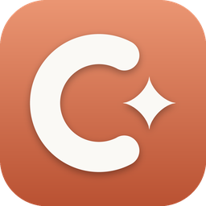

<p align="center"></p>

<h1 align="center">Conduit</h1>

<p align="center">用 iPhone 在任何地方驾驭电脑上的编程 Agent —— Claude · Codex · Pi · opencode</p>

---

Conduit 由三部分组成：

| 组件 | 技术 | 作用 |
|---|---|---|
| **Conduit (iOS)** | SwiftUI · Liquid Glass · ActivityKit · Network.framework | 手机端：会话列表、流式对话、审批、Dynamic Island 实时进度 |
| **Conduit Host (Windows)** | WinUI 3 · .NET 8 · Kestrel | 电脑端：发现并驱动本机 Agent，端到端加密地把它们暴露给手机 |
| **Conduit Relay（可选）** | ASP.NET Core · Docker | 无公网 IP / 不想装 Tailscale 时的中继，只转发密文 |

## 功能

- **四个 Agent，一个界面** —— 每个 Agent 都通过其官方的机器接口驱动，复用你在电脑上已有的登录与配置：
  - **Claude**（Claude Desktop / Claude Code）：`claude -p --input-format stream-json --output-format stream-json --permission-prompt-tool stdio`
    > Claude Desktop 的聊天窗口本身没有对外的远程控制 API，因此 Conduit 驱动的是随 Claude Desktop 一起提供的 Claude Code 引擎（同一账号、同一 CLAUDE.md / MCP 配置）。
  - **Codex**（Codex Desktop / CLI）：`codex app-server` —— 与 Codex 桌面版和 IDE 插件相同的 JSON-RPC 接口
  - **Pi Coding Agent**：`pi --mode rpc --session-id …`
  - **opencode**：`opencode serve`（HTTP + SSE，仅绑定 127.0.0.1，随机密码保护）
- **任意地点连接**，自动选择最快路径：
  - 局域网直连 → Tailscale / ZeroTier（P2P，零配置自动识别 100.x 地址）→ 自建中继
  - 多路并发竞速（Happy Eyeballs），直连有 350 ms 先发优势；走中继时会在后台持续探测直连并**无感迁移**
  - 网络切换（Wi‑Fi ↔ 蜂窝）立即重连；心跳 15 s，断线秒级发现；重连后按序号断点续传，不丢一个字
- **流畅** —— 主机端 33 ms 合并流式增量、日志压缩（增量被最终消息替换、工具调用合并）、TCP_NODELAY、解密与 JSON 解析不占主线程、逐行 Equatable 渲染
- **Dynamic Island / 锁屏实时活动** —— 常驻显示正在运行的 Agent：当前步骤、计划进度环、计时、等待审批提醒、同时运行的 Agent 数；可选由电脑端经 APNs 推送，App 挂起时也保持更新
- **审批** —— 命令执行、文件修改、网络访问等权限请求实时推到手机：允许 / 总是允许 / 拒绝
- **Liquid Glass** —— 遵循 Apple 的液态玻璃设计准则：玻璃只用于浮在内容之上的导航与控件层（Tab Bar、底部 Accessory、工具栏、输入框、审批卡、岛），内容层保持纸张质感；`GlassEffectContainer` 组合相邻玻璃，`glassEffectID` 实现发送/停止按钮与岛的形变动画，主操作用 `.glassProminent` 着色，其余保持中性
- **Claude 式视觉** —— 象牙白纸张、墨色文字、陶土色强调色、New York 衬线标题、克制留白
- **LiveContainer 支持** —— 见下文
- **安全** —— P‑256 ECDH（临时 + 静态，双向认证 + 前向保密）+ HKDF‑SHA256 + AES‑256‑GCM，严格递增帧计数防重放；扫码配对令牌一次性、30 分钟过期；主机私钥用 Windows DPAPI 加密保存；中继看不到任何明文

## 快速开始

1. **电脑端**：从 [Actions](../../actions/workflows/windows.yml) 或 Releases 下载 `ConduitHost-win-x64.zip`（ARM 设备选 arm64），解压后运行 `ConduitHost.exe`。
   - 首次运行时允许 Windows 防火墙（或在 设置 → *Allow through Windows Firewall*）。
   - 在 *Agents* 页确认已检测到 Claude / Codex / Pi / opencode；没装的话页面里有安装命令。想先试用，可打开 *Demo agent*。
2. **手机端**：从 [Actions](../../actions/workflows/ios.yml) 下载 IPA：
   - `Conduit.ipa`：完整版（含 Dynamic Island 小组件扩展），用 AltStore / SideStore / Sideloadly / 自己的证书签名安装
   - `Conduit-LiveContainer.ipa`：LiveContainer 专用（去掉了无法在 LiveContainer 中运行的扩展）
3. 在电脑端打开 **Pair a phone**，用 App 扫码（或复制链接粘贴到 App）。完成。

### 在外面也能连

任选其一：

- **Tailscale（推荐，最低延迟）**：电脑和 iPhone 都装 Tailscale 并登录同一账号。Conduit Host 会自动把 100.x 地址写进配对二维码，手机自动走 P2P。
- **自建中继**：在任意有公网的服务器上
  ```bash
  cd relay && RELAY_DOMAIN=relay.example.com docker compose up -d   # 自动 HTTPS
  ```
  然后在 Conduit Host → 设置 填 `wss://relay.example.com`，重新生成二维码。中继无状态、只转发密文，详见 [relay/README.md](relay/README.md)。
- **端口转发 / DDNS**：在设置里的 *Extra addresses* 填 `ws://你的域名:47821`。

## LiveContainer

Conduit 刻意避开了 LiveContainer 无法提供的能力，因此可以作为 guest App 正常运行：

| LiveContainer 限制 | Conduit 的做法 |
|---|---|
| 不能运行 App Extension（没有 Live Activity UI） | 自动检测并改用 **App 内 Island**：顶部液态玻璃胶囊，点按形变展开，可直接审批；底部 Tab Accessory 显示运行中的 Agent |
| guest 的 Info.plist ATS 设置不生效 | 使用 Network.framework 的 WebSocket，不受 ATS 限制，`ws://` 直连局域网 / Tailscale 正常 |
| 没有 App Group / 推送权限 | 不依赖 App Group；APNs 仅作为可选增强 |
| Keychain 访问组可能不可用 | Keychain 失败时自动回退到受数据保护的文件 |
| 相机可能不可用 | 支持粘贴配对链接（主机端一键复制） |
| VisionKit 扫码不可靠 | 使用 AVFoundation 扫码 |

## 构建

所有产物都由 GitHub Actions 构建：

| Workflow | 运行环境 | 产物 |
|---|---|---|
| `ios.yml` | macOS（自动选最新 Xcode，有 iOS 27 SDK 则用之） | ConduitKit 单元测试；`Conduit.ipa`、`Conduit-LiveContainer.ipa`（未签名） |
| `windows.yml` | Windows | 主机核心测试（协议、加密向量、四个适配器、端到端）；WinUI 3 x64 / arm64 自包含 zip（含 CLI 版） |
| `relay.yml` | Ubuntu | 经真实中继的端到端测试；Docker 镜像（打 tag 时推送到 GHCR） |

推送 `v*` tag 会自动创建 Release。

本地开发：

```bash
# iOS（macOS + Xcode 26/27）
brew install xcodegen && cd ios && xcodegen generate && open Conduit.xcodeproj

# Windows 主机（Visual Studio 2022 + Windows App SDK）或命令行
dotnet test windows/tests/Conduit.Host.Core.Tests
dotnet run --project windows/src/Conduit.Host.Cli -- --demo     # 无界面主机，终端里打印配对二维码
```

## 目录

```
ios/
  ConduitKit/          Swift 包：协议、加密、Network.framework 传输、路由竞速客户端（swift test）
  Conduit/             SwiftUI App（Liquid Glass UI、会话、聊天、配对、App 内 Island）
  ConduitWidgets/      Live Activity（Dynamic Island + 锁屏）
  Shared/              App 与扩展共享：ActivityAttributes、品牌色、Agent 图标
  project.yml          XcodeGen 工程定义
windows/
  src/Conduit.Host.Core/   主机引擎：会话、Agent 适配器、加密连接、Kestrel、中继客户端、APNs
  src/Conduit.Host/        WinUI 3 桌面应用
  src/Conduit.Host.Cli/    无界面主机
  tests/                   xUnit 测试
relay/                 中继服务器 + Dockerfile + docker-compose（Caddy 自动 HTTPS）
docs/PROTOCOL.md       线协议规范
```

## 设计说明

- **iOS 27 / iPhone 18 Pro**：部署目标 iOS 26（Liquid Glass API 起始版本），在 iOS 27 上运行；CI 自动使用 runner 上最新的 Xcode / SDK。界面针对 Dynamic Island 机型设计，App 内 Island 贴合灵动岛下沿。
- 应用名使用 “Conduit”，未沿用仓库名 “Termius”（那是已有的 SSH 客户端商标）。修改 `ios/project.yml` 中的 `CFBundleDisplayName` 和 Windows 项目的 `Product` 即可改名。
- Claude 风格的配色与排版是“致敬”而非复制：火花图标为原创几何图形，不使用 Anthropic 的商标或 Logo。
